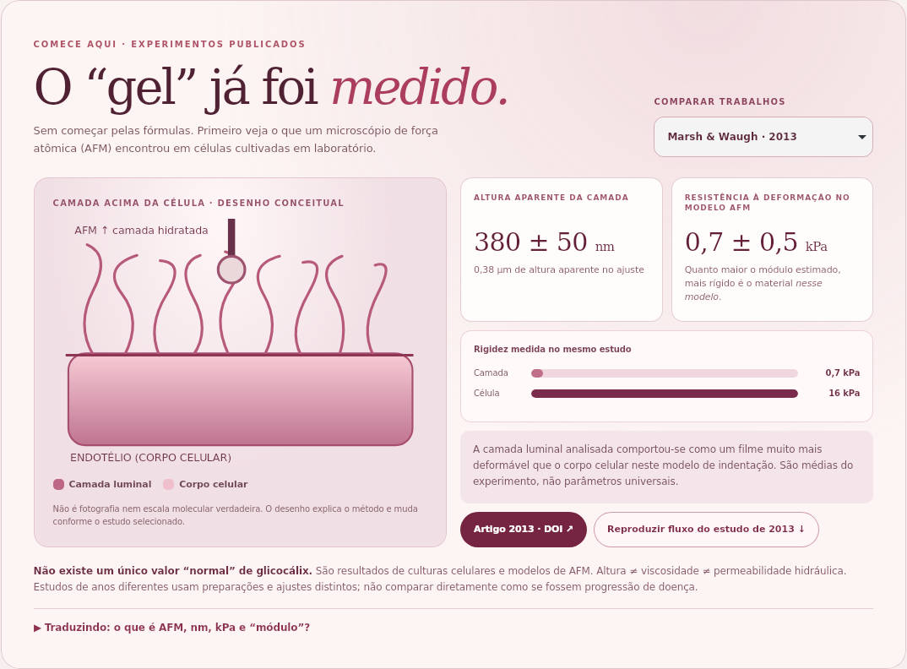

# Revisão visual e metodológica do Laboratório — PR #10

Versão da aplicação verificada: `12ea5364b323a4fb521b9d6ed4d976030b4aa25d`. Antes: `9548d353314a93769d0eec82ab6c740aac5db0fd`. Capturas em runners GitHub Ubuntu, WebKit; desktop 1440×1000 e iPhone 13 emulado a 390 px. Não são capturas de aparelhos físicos. Cabeçalho fixo externo ocultado apenas para capturas longas.

| Desktop antes | Desktop depois |
| --- | --- |
|  |  |

| iPhone emulado antes | iPhone emulado depois |
| --- | --- |
|  |  |

## Verificações
- [Build, 12 testes e navegadores](https://github.com/joyceradis/ESC/actions/runs/38112122881): Chromium + WebKit, desktop/iPhone emulado, larguras 320, 390, 768, 1024 e 1440 sem overflow; nenhum erro JS.
- [Verificar site](https://github.com/joyceradis/ESC/actions/runs/38112122911): sintaxe, testes, sincronização HTML e links.
- Seleção 2013/2020 preserva números, exibe contexto e ressalva corretos e não redimensiona filamentos.
- Condição didática do protocolo de 2013 resulta em 1 Pa; gradiente inferido, viscosidade assumida, sem reproduzir AFM.
- Darcy tem controle independente: alterar viscosidade do fluxo não muda Darcy; duplicar viscosidade permeante reduz sua velocidade pela metade.
- Teclado e movimento reduzido exercitados. Capturas desktop/iPhone inspecionadas visualmente.
- Os artefatos da execução incluem também 2020 e os painéis físicos. [Dados da verificação](validation.json).

## Escopo científico
Ver [nota metodológica](../../../atlas/METODOLOGIA-LABORATORIO.md). A ressalva de 2020 qualifica módulos históricos sem inventar retratação nominal de 2013 ou invalidar automaticamente 380 nm. Cálculos didáticos, evidência endotelial e ilustrações são explicitamente diferenciados. Verificação de código não é validação experimental.

Esta revisão inclui ajustes fora do bloco AFM: rótulos/limitações dos exercícios, viscosidade independente de Darcy e remoção da flexão arbitrária das estruturas. Home, skills do Claude, estados de leitura e valores publicados preservados. Somente nuvem; sem merge, auto-merge ou deploy.
