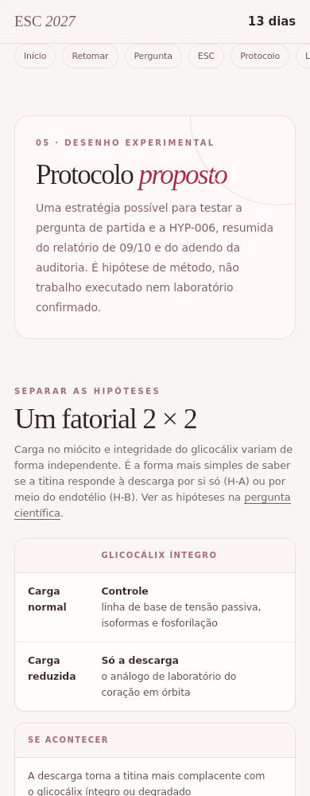
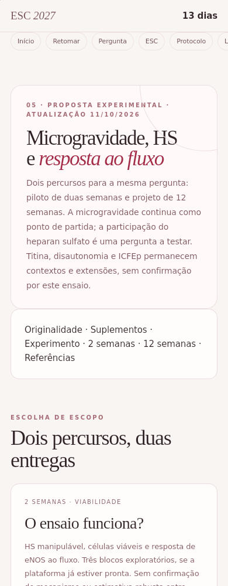
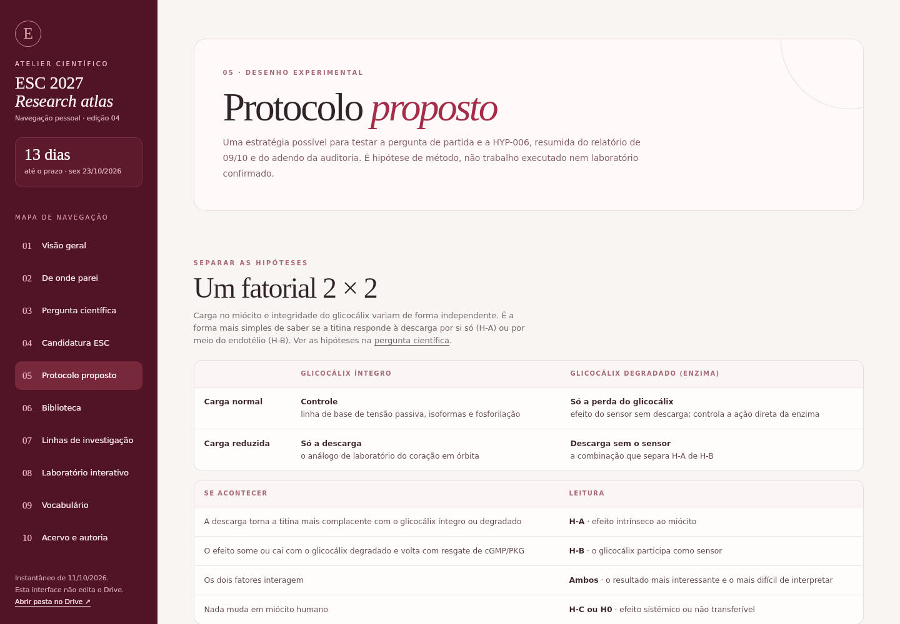
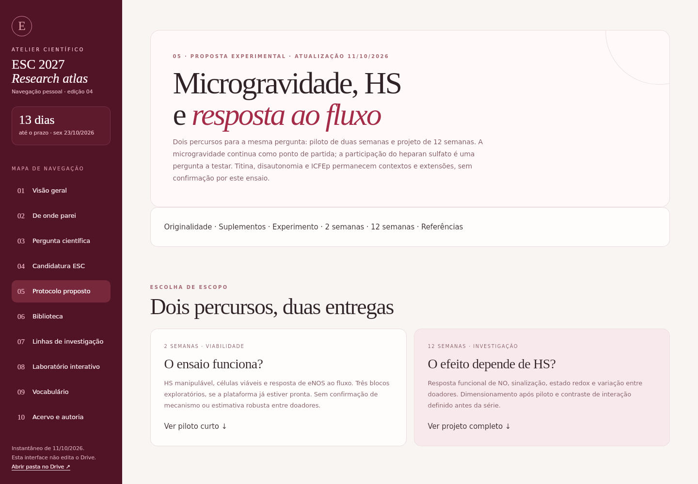

# Revisão da página: HS e resposta ao fluxo

Fonte testada: 25554cf674dbb70aab6870aab6a839ab127a3782.
Base das comparações: db72fbd5fba7ae08c7451940f492c3b54fe07477.

[Execução em nuvem](https://github.com/joyceradis/ESC/actions/runs/38181494459): geração, verificação do site, testes Node e navegação Chromium/WebKit concluídos. Navegação por teclado e ausência de erros de console verificadas em 390 e 1440 px; ausência de transbordamento horizontal verificada também em 320 e 768 px. Preferência de movimento reduzido ativa.

Imagens: WebKit em runner Linux, viewports de 390×1000 e 1440×1000. São aproximações de telas móvel e desktop; não testes em dispositivos físicos Mac/iPhone.

| Viewport | Antes | Depois |
|---|---|---|
| 390 px |  |  |
| 1440 px |  |  |

O protocolo.html deste commit foi copiado sem alterações da saída de tools/build.py nessa execução. Não houve geração local.

[Extração dos suplementos](https://github.com/joyceradis/ESC/actions/runs/38180787365): Pipis 2026, Du 2025 e Harding 2026. A auditoria cobre texto, tabelas e legendas extraídos; não inclui inspeção quadro a quadro dos vídeos. Referências e limites constam na página. Originalidade delimitada à busca realizada; não é prova de ausência universal de anterioridade.

Piloto de duas semanas e projeto mecanístico de 12 semanas são propostas condicionadas à infraestrutura e qualificação do ensaio. Código aprovado não equivale a validação científica ou experimental.
