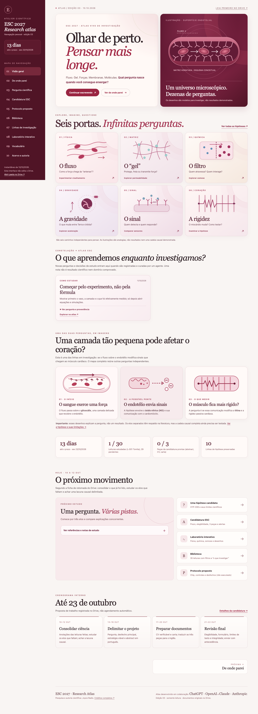
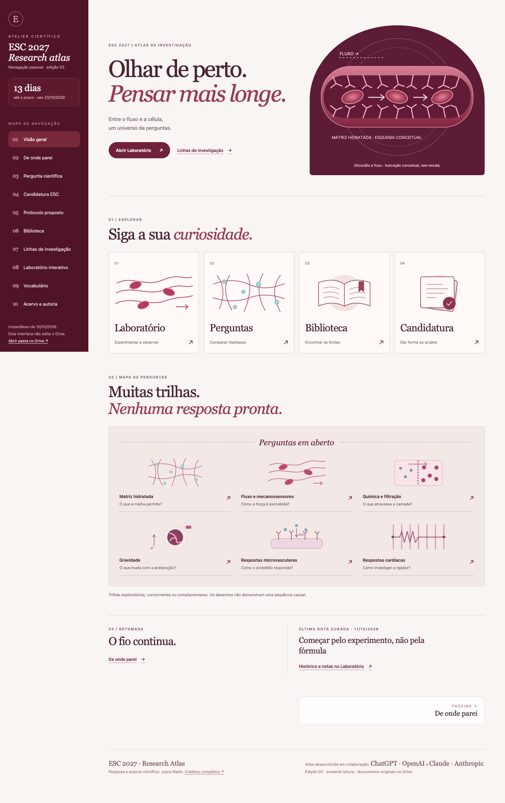
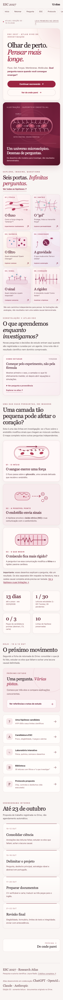
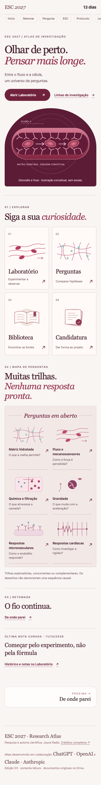

# Issue #8 — revisão visual da Visão geral

Base das imagens: `75d68f4`. Data: 11/10/2026. Capturas de página inteira em WebKit 26.5 no macOS, com movimento reduzido e sessão de teste isolada. Desktop: 1440 × 1000. iPhone 13 emulado: 390 × 664 CSS px, DPR 1 para legibilidade do anexo. Não são capturas de iPhone físico nem evidência de publicação. A barreira visual foi liberada somente na sessão local de teste, sem modificar senha ou código de acesso.

| Mac — antes | Mac — depois |
| --- | --- |
|  |  |

| iPhone emulado — antes | iPhone emulado — depois |
| --- | --- |
|  |  |

## Mudança

A home reúne quatro seções: capa com duas chamadas, quatro destinos ilustrados, mapa de seis trilhas exploratórias e retomada com a última nota curada. Os desenhos são esquemas conceituais, sem uma cadeia causal demonstrada. A capa e as trilhas reaproveitam os SVGs anteriores; Biblioteca e Candidatura recebem ilustrações coerentes com a mesma paleta.

Saíram da home a galeria concorrente de seis destinos, a sequência adicional de três histórias, o mural completo de notas, métricas, fichamento longo, atalhos repetidos e cronograma. O CSS exclusivo desses componentes foi removido, inclusive regras antigas do hero. A nova folha `home.css` só carrega na home e usa o escopo `.esc-home`. Layout e navegação comuns permanecem intactos.

A nota mais recente é gerada durante o build a partir da mesma fonte canônica, sem duplicar registros ou modificar o feed do Laboratório. O título é escapado como texto; há estado vazio.

## Validação

- `python3 build.py`: 10 páginas regeneradas, apenas `index.html` difere da base.
- `python3 tools/check_site.py`: 10 páginas, 35 leituras, 10 hipóteses e 16 termos, sem links ou âncoras quebrados.
- `node --test tests/*.test.mjs`: 14 testes passaram, incluindo três casos da nota compacta (ordenação, ausência de notas, escape de HTML).
- Sintaxe de todos os scripts JavaScript e `git diff --check`: OK.
- Chrome e WebKit: 320, 375, 390, 430, 768, 790, 791, 1024, 1140, 1280 e 1440 px, sem overflow na home; quatro seções e quatro portas em todas as larguras.
- Teclado: 14 links da home alcançáveis e foco visível a 390 e 1440 px nos dois motores. Em WebKit/macOS, teste com Option+Tab (navegação de links), sem alterar preferências do sistema.
- 11 destinos únicos da home abrem em cada motor, incluindo as âncoras; nenhum erro de JavaScript nessas verificações.
- Movimento reduzido: zero animações ativas. Sete pares de cor de texto da home conferidos; menor contraste 4,96:1.
- Nove páginas internas comparadas em ambos os motores, em 390 e 1440 px: 35 capturas idênticas; uma captura do Laboratório/WebKit varia no gradiente no máximo 2/255 por canal. Estilos computados e geometria dessa página também foram comparados, sem alteração.
- 16 arquivos protegidos comparados byte a byte: layout, Laboratório, fórmulas, dados, estudos, notas, senha e skills do Claude preservados.
- Revisão estática independente: nenhum achado acionável.

O relatório estruturado está em [browser-validation.json](browser-validation.json). Limite: emulação móvel não substitui revisão final em um iPhone físico; a validação visual da autora continua pendente.

## Caminhos e risco residual

As quatro portas levam a Laboratório, Hipóteses, Biblioteca e Candidatura. “De onde parei” permanece na retomada e no menu. “Histórico e notas” abre `laboratorio.html#lab-notas`. O Protocolo continua no menu; os documentos “LEIA PRIMEIRO” e o rascunho continuam nas páginas internas. Não foram removidos dados ou páginas. Há mudança intencional de localização dos atalhos e redução de detalhes visíveis na home.

O deploy existente continua restrito a push na `main` ou acionamento manual. Este PR não altera workflows, não faz merge e não aciona publicação. Os anexos de revisão ficam em `.github/`, fora das páginas do site.
