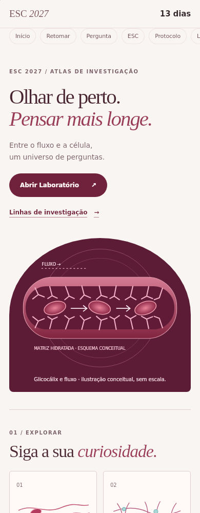
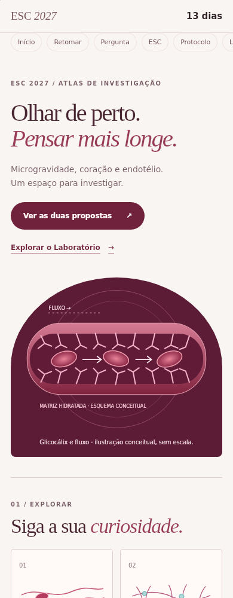
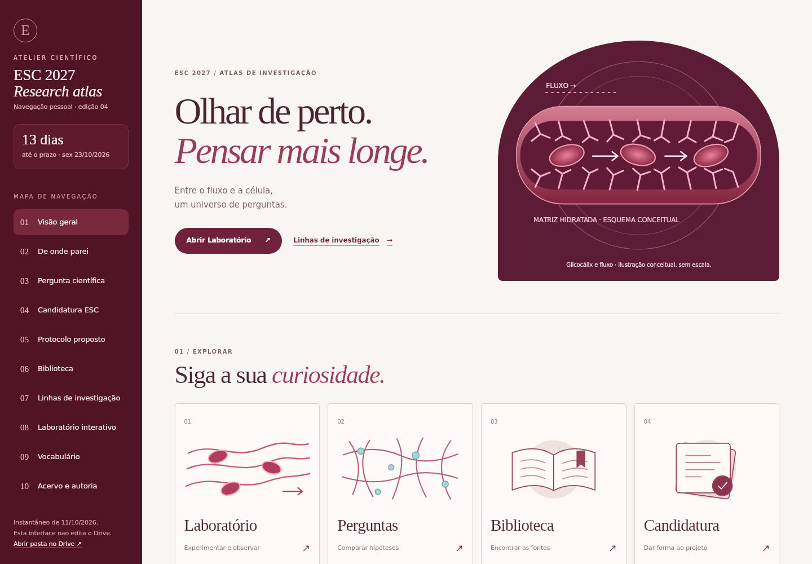
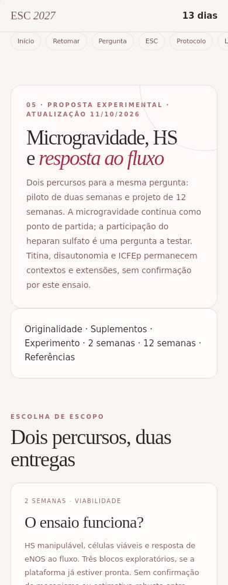
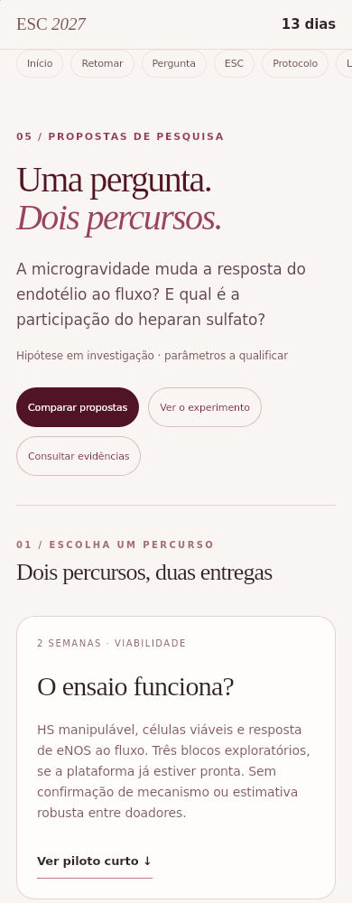
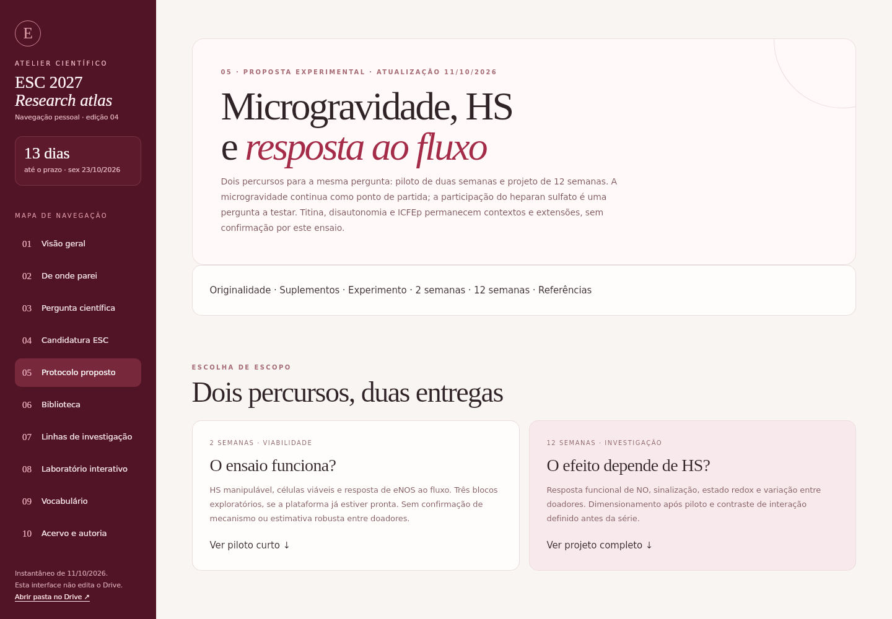
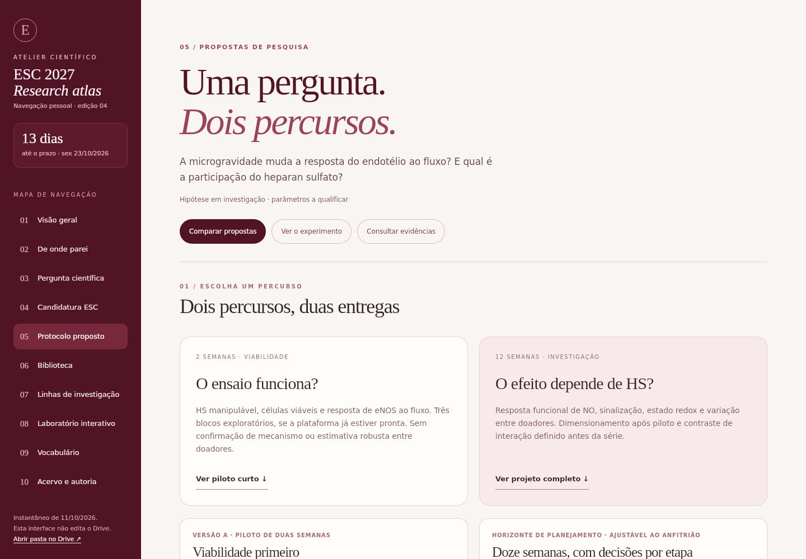

# Revisão do layout — PR #20

## Comparações

Capturas em WebKit/Linux, viewports de 390×1000 e 1440×1000; não são aparelhos físicos.
Fonte visual: commit 18a863fc1d8098c1604572724d2f8d85b37f6360.
Base: 3982dc1451159f484959051140d7a041b1f76fe8.
[Execução das comparações](https://github.com/joyceradis/ESC/actions/runs/38188505972).

| Página / tela | Antes | Depois |
|---|---|---|
| Home / celular |  |  |
| Home / desktop |  |  |
| Protocolo / celular |  |  |
| Protocolo / desktop |  |  |

## Escopo

Home com chamada direta às duas propostas e seis linhas de investigação recolhidas sob demanda.
Protocolo com comparação inicial, dois percursos, sequência experimental e detalhes científicos expansíveis.
Texto visível no protocolo antes da expansão: cerca de 12.632 caracteres na base e 3.013 na revisão, medidos por innerText. Isso mede densidade de leitura, não redução do acervo.
Os parágrafos científicos e links das referências permanecem; introdução e referência posicional do desenho foram ajustadas.
Laboratório, estudos, skills, RASCUNHO e regras de acesso não foram alterados.

## Verificação e histórico de falhas

- A primeira execução falhou por HTML ainda não sincronizado com a fonte; HTML foi obtido da saída de build.py no runner e commitado sem edição manual.
- O teste HS antigo assumia um único expansor: agora verifica os dois níveis, incluindo abrir e fechar com Enter e Espaço.
- A revisão geral no WebKit tentou interagir com summary dentro de um details ancestral fechado (rótulo vazio). O teste foi ampliado para abrir ancestrais pela interface, testar todos os controles, inclusive os antes ignorados, e restaurar o estado. Nenhum check foi dispensado.
- [Revisão visual aprovada após essa correção](https://github.com/joyceradis/ESC/actions/runs/38188662885): Chromium/WebKit, home/protocolo, 320/390/768/1440 px, teclado e movimento reduzido.
- [Integridade do site aprovada](https://github.com/joyceradis/ESC/actions/runs/38188662871).

As capturas foram produzidas antes da última alteração, que afetou apenas a cobertura do teste; código visual idêntico.
Tudo executado na nuvem. A barreira visual foi liberada somente no contexto efêmero de teste pelo estado de sessão já adotado no repositório, sem senha e sem modificar o site.
Merge reservado à Joyce pelo AGENTS.md. Nenhuma regra foi removida, nenhuma proteção foi contornada e não houve publicação.
