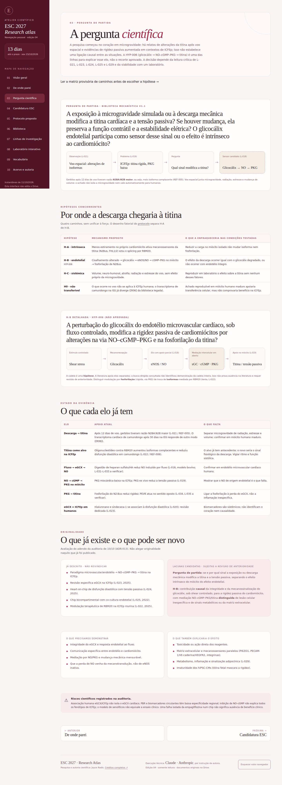
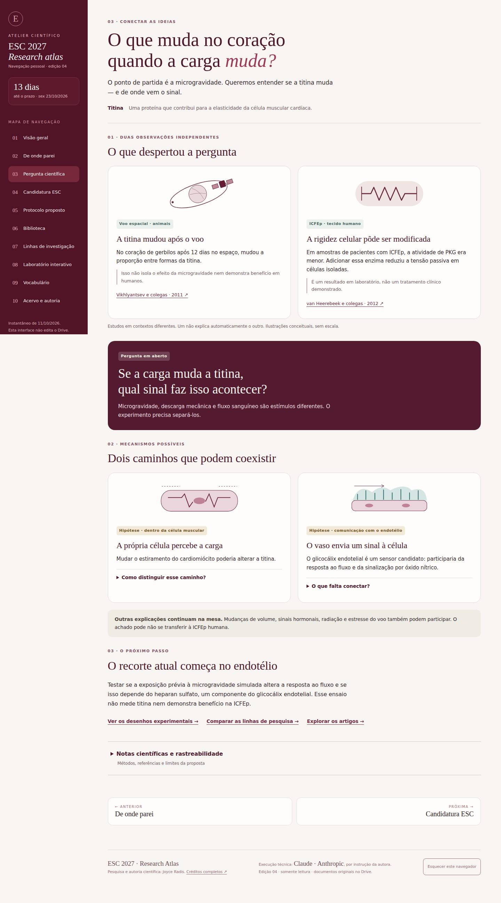
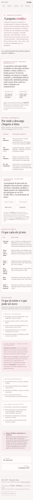
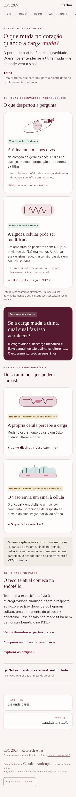

# Pergunta científica — antes/depois
Capturas reais do GitHub Actions [execução 38190129978](https://github.com/joyceradis/ESC/actions/runs/38190129978), fonte e7fd95b243ca16fc37d6f279ff12a36ec5c06d16, base f60cfcf65e4d65cff561f94a90259ad79e54fa5e.
A página foi gerada com build.py no runner. A captura é de ambiente de teste, não da publicação.

## Desktop · Chromium · 1440 px
| Antes | Depois |
| --- | --- |
|  |  |

## Celular · WebKit · 390 px
| Antes | Depois |
| --- | --- |
|  |  |

## Validação
Oito combinações passaram: Chromium e WebKit, larguras 320, 390, 768 e 1440. Detalhes fechados inicialmente, operação por teclado, referências internas fora da leitura inicial, navegação, integridade das tabelas técnicas e ausência de overflow da página com detalhes abertos/fechados. Redução de movimento habilitada. Capturas desktop/celular inspecionadas visualmente pelo executor. Emulação de viewport em Linux; não teste em Mac/iPhone físico.

Revisão independente da fonte e do desenho conceitual identificou e confirmou a correção da ligação indevida entre protocolo HS/fluxo e discriminação de mecanismos sobre a titina. O revisor não inspecionou screenshots nem certificou os artigos completos. Resumos primários dos três artigos foram conferidos pelo executor; isso não altera status de leitura da autora.

Mudança mantém identidade vinho/marfim e os detalhes técnicos, corrigindo uma frase desatualizada do protocolo. Sem alteração de Laboratório, fontes do acervo, skills, RASCUNHO ou publicações.
