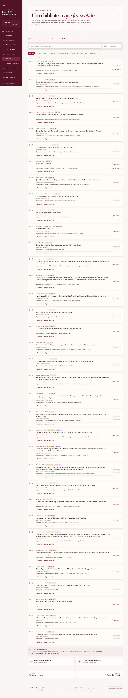
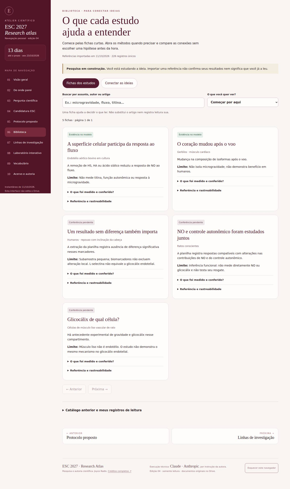
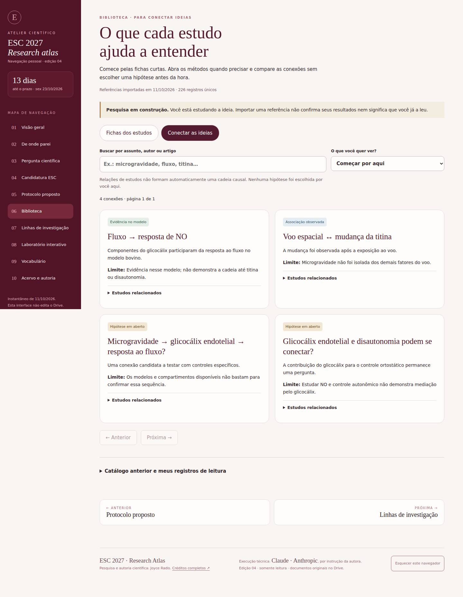

# Biblioteca — revisão das fichas e conexões

Capturas produzidas em GitHub Actions, sem acesso ao Mac. São navegadores em Linux com dimensões desktop/celular; não testes em aparelhos físicos.

Código executado: `a0d7b010a99a740e9bde83b82374cc3cdc6ec600`.
[Execução e artefatos](https://github.com/joyceradis/ESC/actions/runs/38191905580).
Antes: main `f60cfcf65e4d65cff561f94a90259ad79e54fa5e`.

## Desktop — Chromium, 1440 px

| Antes | Fichas | Conexões |
| --- | --- | --- |
|  |  |  |

## Celular — WebKit, 390 px

| Antes | Fichas | Conexões |
| --- | --- | --- |
|  |  |  |

## Verificação

- 22 testes Python e 15 testes Node passaram.
- Chromium e WebKit em 320, 390, 768 e 1440 px: 8 combinações aprovadas.
- Busca, filtros, paginação, detalhes por teclado, ausência de overflow horizontal e renderização segura de texto.
- Catálogo: 226 referências; cinco fichas iniciais e quatro conexões. O restante fica pendente de curadoria.
- Revisão por pares identificou dependências de conexões e conflitos de metadados; corrigidos e cobertos por testes.
- Os testes não substituem nova leitura integral dos artigos nem validam as hipóteses científicas.
- A identidade Google para GitHub Actions ainda precisa ser configurada; o teste real OIDC → Sheets → PR está pendente. A primeira importação usou o conector autorizado. Não há sincronização recorrente ativa.

Sem alteração no RASCUNHO e sem merge/publicação. As imagens registram a versão executada acima; este diretório apenas acrescenta evidência ao PR.
