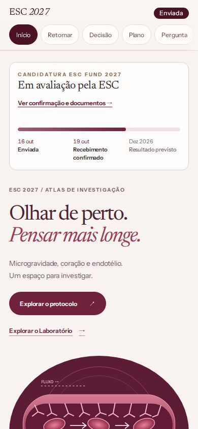
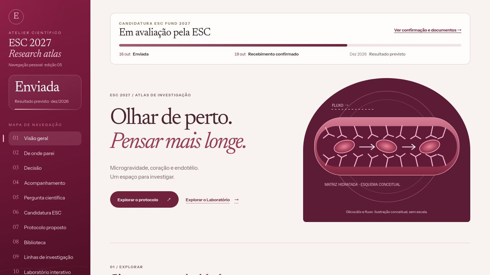
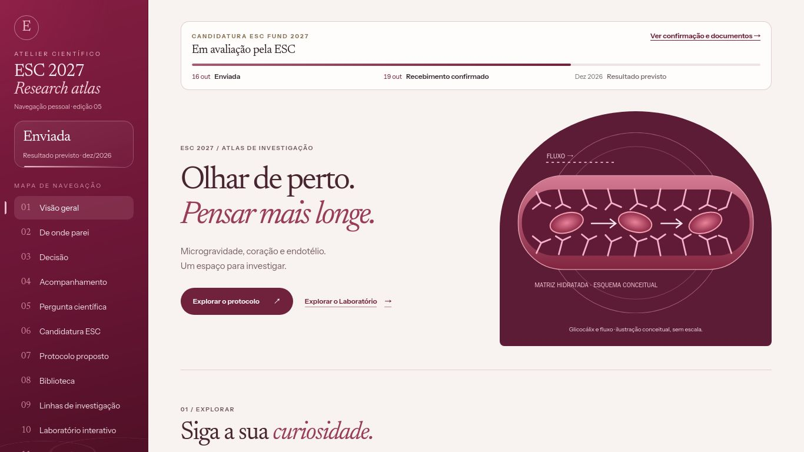
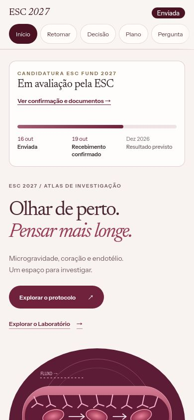
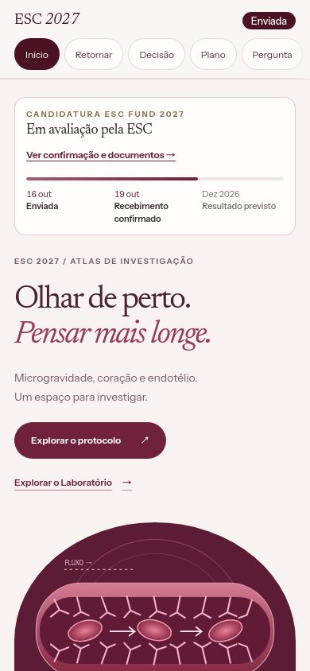
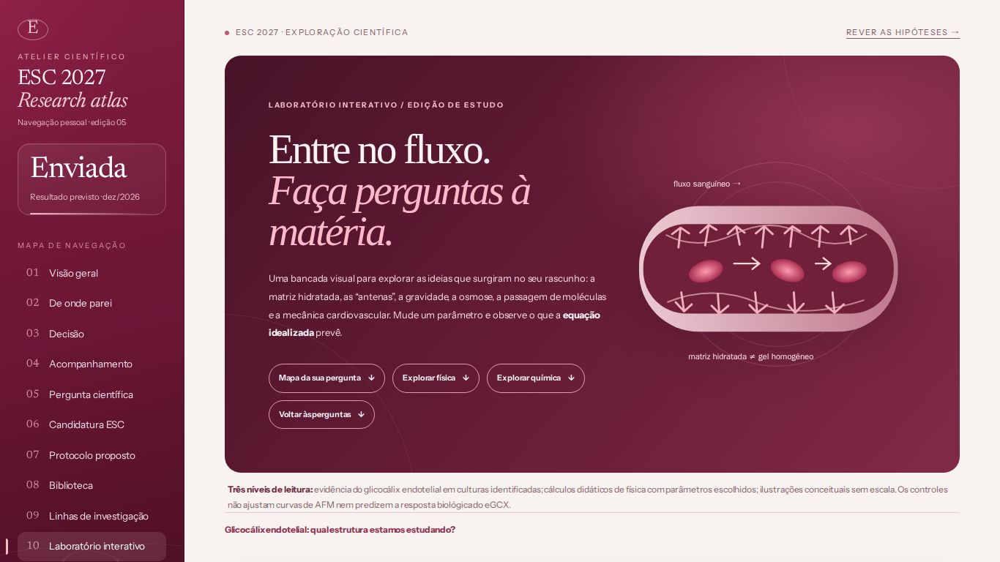
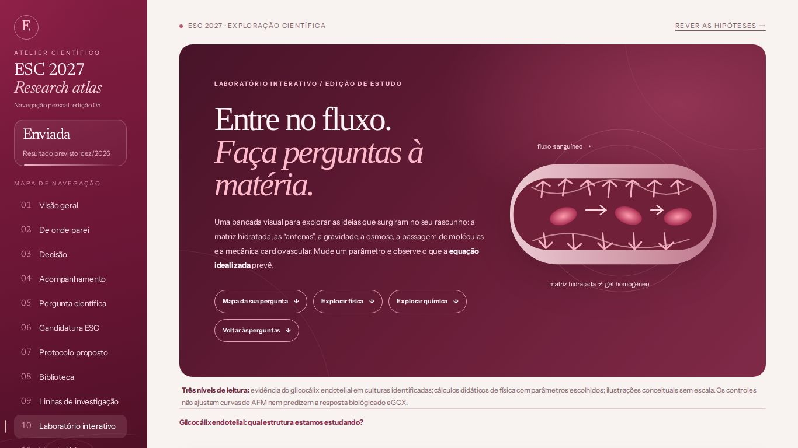
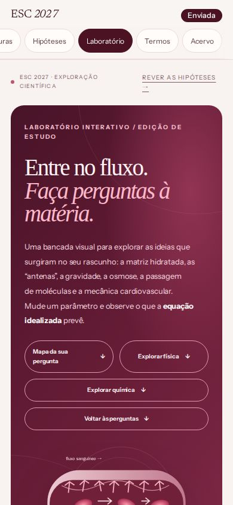
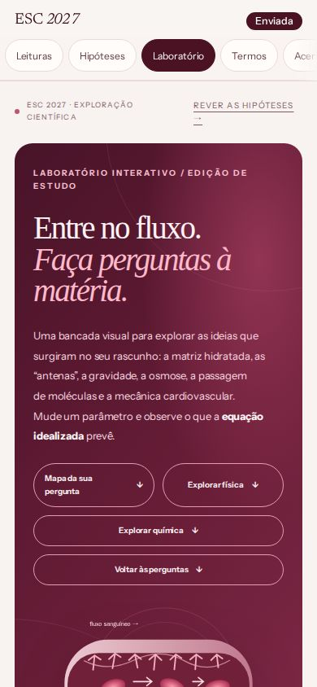

# Revisão da apresentação — 22/10/2026

Referência: [main em b2b2c42](https://github.com/joyceradis/ESC/commit/b2b2c42d16d119a6b6435ce42067f8a923045311), que inclui o PR #80 e a correção vinho-rubi posterior. As capturas “before” e “after” usam o mesmo ambiente, viewport, fontes e preferência por movimento reduzido.

## Resultado

- Status da candidatura mais compacto; os três marcos administrativos e a barra acessível continuam presentes.
- Hero com tipografia e espaçamento ajustados, preservando a ilustração, textos e acesso ao laboratório.
- Lateral com rolagem nativa: marca, navegação e rodapé não são comprimidos pela altura da janela. Os 12 destinos continuam acessíveis por teclado.
- Monograma circular, com 42 × 42 px e centro horizontal coincidente com o texto; deslocamento vertical da caixa tipográfica de −1 px.
- Abas móveis sem snap que cortava o último destino; ao receber foco, cada rótulo fica visível por inteiro.

| Medição em Chromium | Antes | Depois |
| --- | ---: | ---: |
| Altura do status, 1366 × 768 | 144,02 px | 117,80 px (−18,2%) |
| Altura do status, 390 × 844 | 212,53 px | 173,17 px (−18,5%) |
| Monograma, notebook | 42 × 29 px | 42 × 42 px |

**Paleta preservada:** nenhuma definição de cor foi alterada nos CSS modificados. As cores computadas também coincidem em todas as comparações: fundo off-white, tokens vinho, gradiente vinho-rubi da lateral, vinho da home, fundo da ilustração e gradiente rosado da barra. O arquivo `sidebar-vinho-rubi.css` permanece intacto.

**Conteúdo preservado:** fontes HTML, páginas geradas, atlas, dados, estilos e módulos próprios do laboratório não foram modificados. A mudança em `app.js` está restrita ao foco das abas de navegação. Workflows, governança, acesso e credenciais não foram alterados.

## Evidências visuais

28 capturas versionadas nesta pasta, em Chromium e WebKit: home e laboratório em 1440 × 900, 1366 × 768 e 390 × 844, antes/depois; mais a lateral rolada até o último destino.

| Home | Antes | Depois |
| --- | --- | --- |
| Notebook · Chromium |  |  |
| Celular · Chromium |  |  |
| Notebook · WebKit |  |  |
| Celular · WebKit |  |  |

| Laboratório | Antes | Depois |
| --- | --- | --- |
| Notebook |  |  |
| Celular |  |  |

[Menu completo com foco no último destino](chromium-menu-1366x768-after.jpg).

## Testes realmente executados

| Verificação | Resultado |
| --- | --- |
| Build e integridade de páginas, links e dados | 12 páginas verificadas |
| Testes JavaScript existentes | 84 passaram |
| Testes Python | 28 passaram |
| Sintaxe de todos os scripts da aplicação e do novo verificador | Passou |
| Páginas e dados gerados versus Git | Sem diferenças |
| Navegadores | 76 casos da referência + 76 da correção |
| Casos da versão corrigida | 0 falhas; 0 regressões de cor |
| Controle do laboratório e link da home para o laboratório | Passaram |
| Teclado, acesso ao último destino e movimento reduzido | Passaram |

Tamanhos: 1440 × 900, 1366 × 768, 1280 × 600, 1024 × 768, 791 × 700, 790 × 844, 390 × 844, 320 × 700 e 844 × 390. Home e laboratório cobertos em todos os tamanhos; as demais dez páginas, em notebook e celular. Dois motores: Chromium e WebKit.

A referência reproduziu três casos em que a última aba ficava parcialmente fora da área visível. Nenhum deles permanece na versão corrigida.

- [Resultados completos, métricas e capturas por caso](report.json).
- [Ambiente, contagens e SHA-256 das fontes testadas](validation.json).
- Código de interface testado e publicado no commit [a6387ec](https://github.com/joyceradis/ESC/commit/a6387ecf35ca58a82fc1b6e5e794657255f92457). Os hashes Git dos quatro arquivos publicados foram comparados com os arquivos executados na VM e coincidem.

## Reprodução somente na nuvem

Em runner ou VM temporária, com Python e Node disponíveis:

```sh
git worktree add --detach /tmp/esc-before b2b2c42d16d119a6b6435ce42067f8a923045311
npm install --prefix /tmp/esc-visual --no-save --no-package-lock playwright@1.64.1
/tmp/esc-visual/node_modules/.bin/playwright install --with-deps chromium webkit

python3 build.py
python3 tools/check_site.py
python3 -m unittest discover -s tests -p 'test_*.py'
node --test tests/*.test.mjs

NODE_PATH=/tmp/esc-visual/node_modules \
ESC_REFERENCE_ROOT=/tmp/esc-before \
ESC_REFERENCE_SHA=b2b2c42d16d119a6b6435ce42067f8a923045311 \
node tools/check_presentation.cjs
```

O verificador usa o mesmo estado efêmero de teste da barreira visual já empregado pelo workflow do projeto; nenhuma senha ou configuração de acesso é modificada.

**Limites:** revisão em VM Linux, com viewports de celular; não equivale a um iPhone físico. As capturas mostram a branch testada, e não uma publicação em produção. A triagem de governança requer revisão humana para o novo verificador em `tools/`; seu resultado verde não aprova merge. A decisão final permanece com Joyce.
